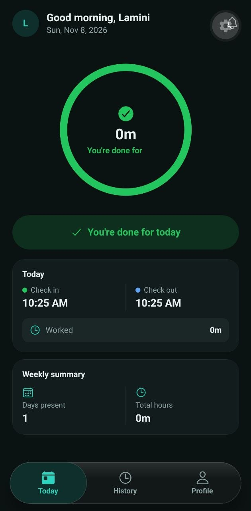
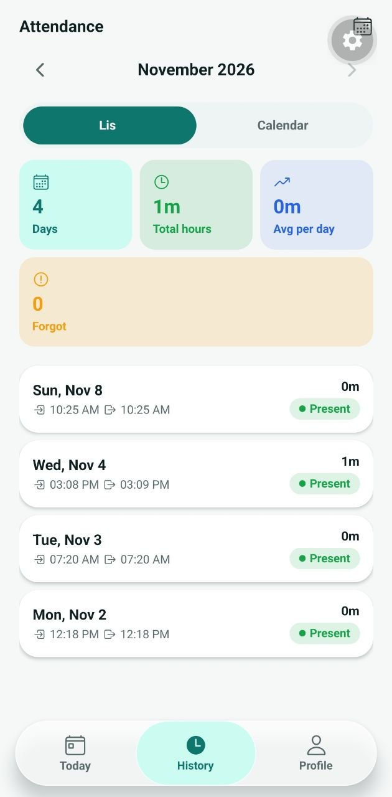

# Attendance Management System

A full-stack attendance platform for companies. Employees check in and out from a **mobile app** by scanning a short-lived QR code displayed at the entrance. Employers and admins manage teams, review attendance and export reports from a **web dashboard**. Both talk to one **REST API**.

> Live demo: `<web-app-url>` · API health check: `https://attendance-management-system-h8u0.onrender.com/health`

## Screenshots

| Web dashboard | Entry QR page |
| --- | --- |
|  |  |

| Mobile — Today | Mobile — Attendance history |
| --- | --- |
|  |  |


## Features

**Mobile app (employees)**
- Check in and check out by scanning the entry QR code
- Attendance history with status: on time, late, absent, incomplete, rest day
- Change password, light and dark themes

**Web app (employers and admins)**
- Employer dashboard: employees, attendance tracking, reports exportable to CSV and Excel
- Entry QR page: a QR code that refreshes every 30 seconds, meant to be shown on a screen at the entrance
- Admin dashboard: approve or reject employer accounts
- Light and dark themes

**Backend**
- Access and refresh tokens with refresh rotation
- Role-based access (admin, employer, employee)
- Attendance rules enforced on the server, never on the phone

## Business rules

| Rule | Value |
| --- | --- |
| Working days | Sunday to Thursday |
| Rest days | Friday and Saturday (check-in and check-out rejected, never counted as absent) |
| Earliest check-in | 08:00 (Africa/Algiers server time) |
| Late | After 08:15 (15-minute grace period) |
| Check-in / check-out | One of each per employee per day |
| Minimum shift before check-out | 30 minutes |
| Incomplete | Check-in without check-out on a past day: no hours counted, flagged for review |
| Entry QR | Signed token (JWT), valid for 30 seconds, tied to one employer |

Any QR code other than the current entry QR is rejected with "Invalid or expired QR code."

## Tech stack

| Part | Stack |
| --- | --- |
| Backend | Node.js, Express, TypeScript, Prisma, PostgreSQL |
| Web | Next.js, TypeScript, Tailwind CSS, shadcn/ui |
| Mobile | Expo (React Native), Expo Router, expo-camera |
| Hosting | Render (API), Neon (PostgreSQL), Expo EAS (Android build) |

## Project structure

```
.
├── backend/    Express API (src/features/*, src/shared/*, prisma/)
├── web/        Next.js dashboards for admins and employers
└── mobile/     Expo app for employees
```

<!-- Replace `web/` with the real folder name of the Next.js app. -->

## Getting started

### Prerequisites
- Node.js 22.13+ or 24 (the backend is pinned to 22.14.0)
- A PostgreSQL database (Neon or local)
- Expo Go on your phone, or an Android emulator

### 1. Backend

```bash
cd backend
npm install
cp .env.example .env      # then fill in the values below
npx prisma migrate deploy
npm run dev
```

Environment variables (see `.env.example` for the full list):

| Variable | Purpose |
| --- | --- |
| `DATABASE_URL` | PostgreSQL connection string |
| `ATTENDANCE_QR_SECRET` | Secret used to sign the entry QR tokens. Use a long random string, separate from the auth secrets |
| JWT secrets | Signing keys for access and refresh tokens (names as in `.env.example`) |

Generate a secret:

```bash
node -e "console.log(require('crypto').randomBytes(48).toString('hex'))"
```

### 2. Web app

```bash
cd web
npm install
npm run dev
```

Set the API address in the web app's `.env` (variable name as in its `.env.example`).

### 3. Mobile app

```bash
cd mobile
npm install
```

Create `mobile/.env`:

```
EXPO_PUBLIC_API_URL=https://<your-api-host>/api
```

Never use `localhost` here: on a phone it points to the phone itself. Use your deployed API or your computer's local network address.

```bash
npx expo start -c
```

Scan the QR code with Expo Go. The camera is needed for check-in, so test on a real phone.

## Building the Android app

```bash
cd mobile
npm install -g eas-cli
eas login
eas build -p android --profile preview
```

The `preview` profile in `eas.json` produces an installable `.apk` and carries `EXPO_PUBLIC_API_URL`, because the cloud build cannot see your local `.env`.

## Deployment

- **API:** Render web service. Build command: `npm install --include=dev && npx prisma generate && npx prisma migrate deploy && npm run build`. Start command: `npm start`. Set every environment variable above in the Render dashboard.
- **Health check:** `GET /health` returns `{ ok: true }` without touching the database. Point an uptime monitor at it every 5 minutes to avoid Render free-tier cold starts (30-60 seconds).
- **Database:** Neon PostgreSQL.
- **Web:** Vercel.

## How check-in works

1. The employer opens the **Entry QR** page on a screen at the entrance. It fetches a signed token every ~25 seconds.
2. The employee taps **Check in** in the mobile app and scans the QR code.
3. The app sends the scanned token to the API. The server verifies the signature, expiry and employer, then checks the rest-day, earliest-time and one-per-day rules, in that order.
4. The server records the time using its own clock and returns the status (on time or late).

## Author

**Abderahim Briek**: [GitHub](https://github.com/raheemnbrk) · [LinkedIn](https://www.linkedin.com/in/abderahim-briek-96002b263/) · [Portfolio](https://my-portfolio-wine-five-67.vercel.app/)
